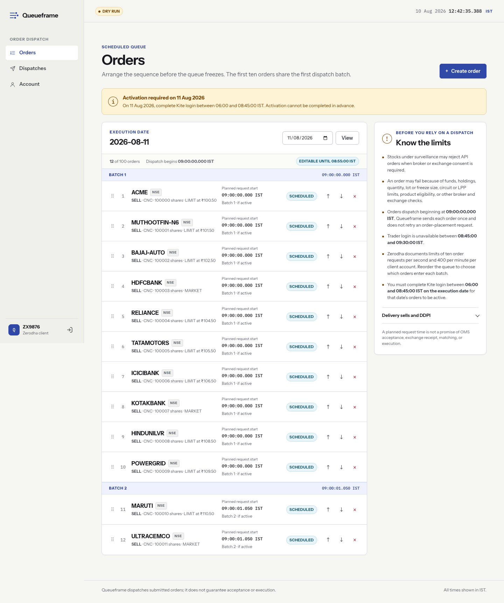
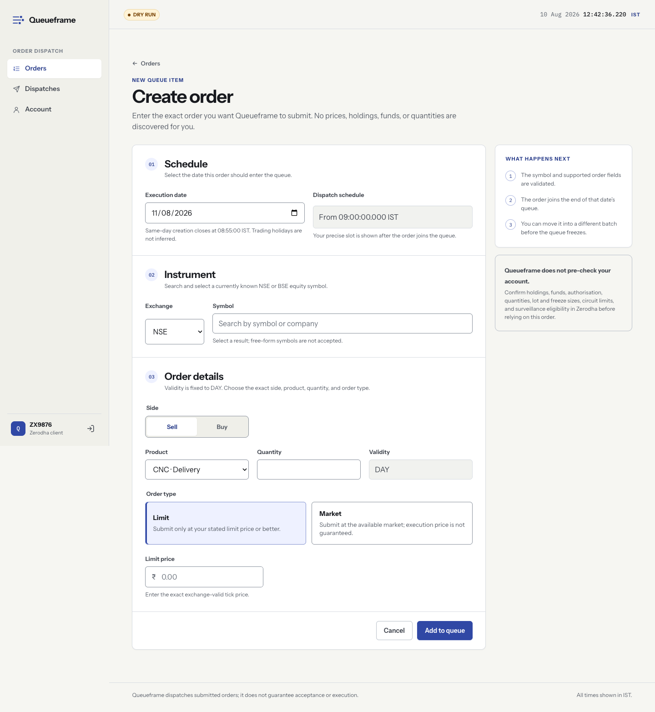
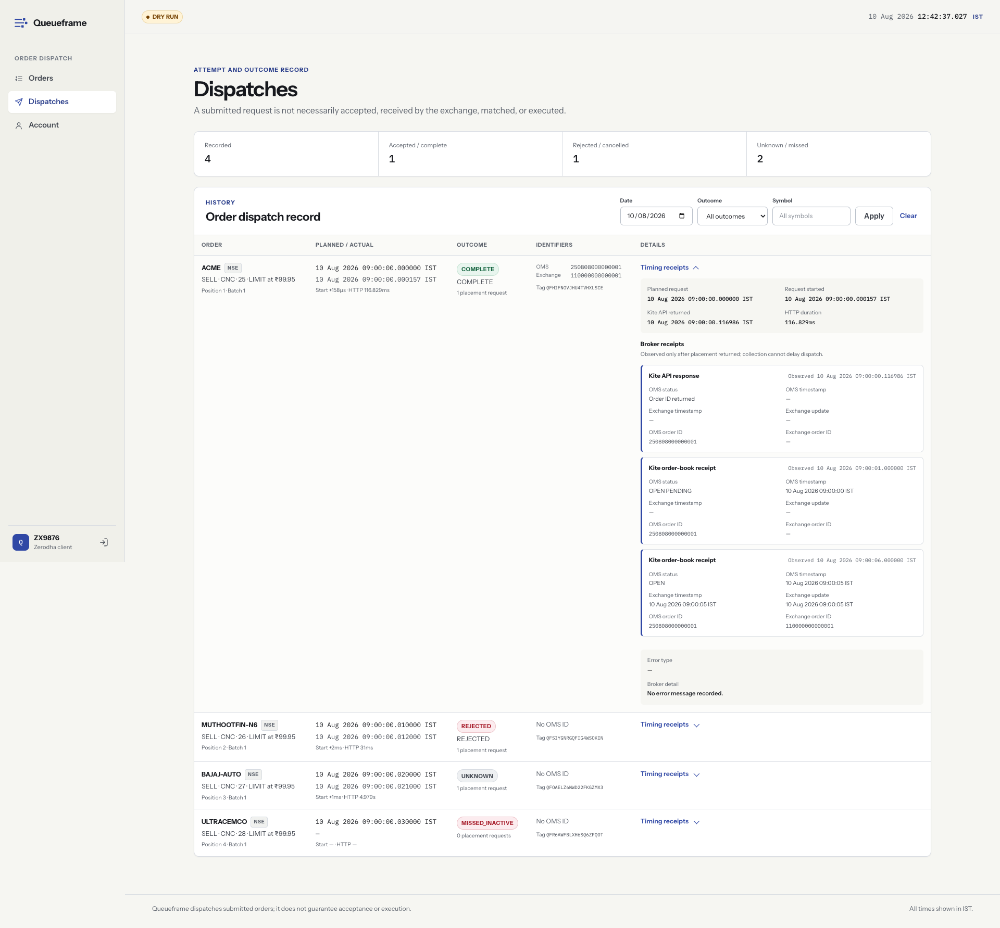

# Queueframe

[](https://github.com/abinthomasonline/queueframe/actions/workflows/ci.yml)
[](LICENSE)

Queueframe is a private, self-hosted web application for preparing Zerodha Kite
Connect orders in advance and starting their placement requests at a configured
time in `Asia/Kolkata`. It was built for time-sensitive orders where reaching
the exchange queue early matters.

You choose every order parameter—symbol, side, quantity, product, order type,
price and date. Queueframe does not discover opportunities, prices, holdings or
balances, and it never retries a placement request. It targets API request time;
it cannot guarantee when Zerodha accepts an order, when the exchange receives
it, or whether it is matched or filled.

Queueframe is intended for one person or the immediate family members Zerodha
permits to share a developer account and static IP. It is not a hosted trading
service or a general-purpose public multi-tenant platform.

## How it works

1. An administrator deploys one Queueframe instance with a stable outbound IP
   and creates an invitation for a permitted trader.
2. The trader supplies their Zerodha client ID and Kite Connect API key and
   secret, then completes Kite's interactive login. Queueframe verifies that
   the returned identity matches the submitted account.
3. The trader creates dated orders and rearranges them into priority order.
   Symbols are checked against Zerodha's NSE/BSE equity instrument master, but
   no quote, holding or balance lookup is performed.
4. On the execution date, the trader completes Kite login at or after
   `06:00 IST`. Before dispatch, Queueframe freezes the day's queue and prepares
   the credentials, clients and request payloads in memory.
5. At the configured target, Queueframe releases up to ten placement requests
   concurrently. Later groups have independent absolute targets so one slow or
   failed request cannot delay the next group.
6. After placement has finished, read-only monitoring adds the OMS/exchange
   identifiers, status transitions and timestamps exposed by Kite to the
   dispatch receipt. Monitoring does not add work to the placement hot path.

The default request-start target is `09:00:00 IST`, but the administrator can
change it. Every placement is attempted at most once.

## Screenshots

### Prepare and prioritize the queue



### Create an order



### Review dispatch receipts



_Screenshots contain demonstration data, not live account credentials._

## Set up Queueframe

### Requirements

- A Linux host with Docker Engine, Docker Compose and OpenSSL. For a small
  household instance, 1 shared vCPU, 1 GB RAM and 10 GB of local SSD storage is
  ample.
- A stable public **outbound** IP, entered in Zerodha's static-IP whitelist.
- A TOTP-enabled Zerodha account and one Kite Connect app for each connected
  client ID.
- Correct host clock synchronisation through NTP.
- HTTPS for every browser URL other than `localhost`.

Stable egress and clock accuracy matter more than additional CPU. Run exactly
one Queueframe process against its SQLite database and keep the database on a
local persistent filesystem.

### 1. Choose browser access

Browser access and outbound Kite traffic are separate: every option still
needs a stable public egress IP.

| Mode | Best for | Domain | Browser access |
| --- | --- | --- | --- |
| Domain + Caddy | Recommended household deployment | Required | Public trusted HTTPS |
| Tailscale Serve | Private deployment without a domain | Not required | Trusted HTTPS inside one tailnet |
| Public IP certificate | Advanced no-domain fallback | Not required | Public trusted HTTPS at the numeric IP |

Domain + Caddy is the simplest default. Tailscale Serve is the preferred
no-domain option when every permitted family device can join one tailnet.
Numeric-IP certificates are short-lived and require continuously healthy
automatic renewal.

The [deployment guide](docs/deployment.md) explains every mode. For the
recommended cloud path, use the [AWS Mumbai guide](docs/aws.md). In a 2018 Kite
Connect forum reply, Zerodha staff [pointed Kite workloads toward AWS
Mumbai](https://kite.trade/forum/discussion/comment/15653/#Comment_15653),
while noting that REST traffic is behind Cloudflare and regional latency can
therefore be negligible within India. Region selection does not guarantee
request latency, exchange receipt, or fills. [Google Cloud Mumbai](docs/gcp.md)
remains a supported alternative.

### 2. Install and start

Reserve the outbound address first. For domain mode, point the chosen DNS name
to the server and allow inbound TCP 80/443; do not expose application port
8080.

```sh
git clone https://github.com/abinthomasonline/queueframe.git
cd queueframe
./deploy/setup.sh
./deploy/doctor.sh
docker compose --project-directory deploy --env-file deploy/.env \
  -f deploy/compose.yaml up --build -d
./deploy/doctor.sh --running
```

The interactive setup selects the access mode, generates the encryption key,
collects the administrator credentials and writes `deploy/.env` with mode
`600`. It leaves `QUEUEFRAME_DRY_RUN=true`.

After the first administrator login and a successful running check, remove the
one-time bootstrap password and any Tailscale enrollment key from the deployed
container configuration:

```sh
./deploy/seal.sh
```

Keep `deploy/.env`, its master key and the SQLite data backed up together.
Losing the key makes stored Kite credentials unrecoverable.

Tagged releases also publish public `amd64` and `arm64` container images with
an SBOM and build provenance. Pin an image by digest as described in the
[self-hosting guide](deploy/README.md#operations).

### 3. Configure Kite Connect

For each trader:

1. Enable TOTP on the Zerodha account and create a Kite Connect app.
2. Add the deployment's static outbound IP to Zerodha's whitelist.
3. Set the app redirect URL exactly to:

   ```text
   <QUEUEFRAME_BASE_URL>/auth/kite/callback
   ```

4. Keep the app's API key and secret ready for the invitation flow.

Queueframe displays both the configured egress IP and exact callback URL on
the signup page. Review Zerodha's current
[static-IP rules](https://support.zerodha.com/category/trading-and-markets/general-kite/kite-api/articles/static-ip)
before connecting a family member.

### 4. Invite and onboard a trader

1. Sign in at `<QUEUEFRAME_BASE_URL>/admin/login`.
2. Open **Invitations**, create a short-lived single-use link and send it
   privately to one permitted person.
3. The recipient opens the link, enters their client ID, API key and API secret,
   accepts the household/static-IP declaration, and completes Kite login.
4. Queueframe verifies the Kite profile before consuming the invitation.

Returning traders enter only their Zerodha client ID and authenticate through
Kite again. Queueframe never automates Zerodha login or TOTP.

### 5. Rehearse, then enable live placement

Complete the whole workflow in dry-run mode first: connect an account, create
and reorder test orders, perform same-day activation, wait through preparation,
and inspect the resulting dispatch receipts. Dry-run uses real Kite login,
profile and instrument-master reads but replaces placement with a synthetic
local acknowledgement.

Only after a successful rehearsal should the operator set
`QUEUEFRAME_DRY_RUN=false` in `deploy/.env`, recreate the stack and rerun the
deployment checks. Enabling live mode authorizes real broker order requests.

```sh
docker compose --project-directory deploy --env-file deploy/.env \
  -f deploy/compose.yaml up -d --force-recreate
./deploy/doctor.sh --running
```

Read [security](docs/security.md), [deployment](docs/deployment.md) and
[operations](docs/operations.md) before enabling live placement.

## Using Queueframe

1. Sign in through Kite after `06:00 IST` on the execution date and before the
   configured login blackout. A previous day's login does not activate today's
   queue.
2. Create an order for an unfrozen weekday. Choose the symbol from instrument
   search and explicitly enter every broker parameter.
3. Reorder the queue to assign priority. Positions 1–10 share the first target,
   positions 11–20 share the next target, and so on.
4. Keep the instance running from before preparation until dispatch results
   have been persisted.
5. Review **Dispatches** alongside Kite's order book. A receipt distinguishes
   Queueframe's request target/start/finish from the OMS and exchange
   timestamps exposed by Kite.

`ACKNOWLEDGED` means Kite initially accepted the API request; it is not proof
of exchange receipt or a fill. Read-only monitoring can later replace it with
`COMPLETE`, `REJECTED` or `CANCELLED` when Kite exposes a terminal state.

## Features

- Responsive server-rendered pages for signup, trader and administrator
  workflows, with a live millisecond IST clock.
- Invitation-only household enrollment and returning-user Kite authentication.
- Encrypted Kite credentials and access tokens that are never returned to
  browser JavaScript.
- Searchable, in-memory NSE/BSE equity symbol validation.
- Regular NSE/BSE `LIMIT` and `MARKET` orders with fixed `DAY` validity.
- Drag/button queue reordering, deletion and recalculated dispatch targets.
- Versioned administrator settings for dispatch, preparation, login blackout,
  batch interval and queue size.
- Per-order receipts with planned, local request, OMS and exchange milestones;
  order and exchange IDs; broker statuses; and observation history.
- Trader and global-administrator dispatch history.
- Local trader deletion with redacted dispatch/audit retention.
- Safe dry-run placement enabled by default.

## Architecture

```text
Browser
   │ HTTPS
   ▼
Caddy or Tailscale Serve
   │
   ▼
Queueframe (single Go process) ─── SQLite on local persistent storage
   │
   ├── server-rendered trader/admin UI
   └── in-memory prepared scheduler ─── gokiteconnect ─── Kite OMS ─── exchange
```

The application uses Go, SQLite and Zerodha's official
`gokiteconnect/v4` client. SQLite handles durable configuration, orders,
sessions, audit records and dispatch history. At the preparation cutoff,
placement inputs are loaded into memory; SQLite and normal application logging
are excluded from the request-placement hot path. Receipt enrichment starts
after placement workers finish.

## Timing and failure model

At the configured preparation cutoff—five minutes before dispatch by
default—Queueframe freezes the date and prepares every credential, client,
tag, payload, position and absolute request target in memory.

Each group contains at most ten requests. Workers are created before their
absolute target and released concurrently; the next group's timer is
independent. Concurrent requests within one group have no guaranteed relative
ordering after they leave Queueframe. The queue cap cannot exceed Zerodha's
documented 400 order requests per minute.

Every placement request is attempted **at most once**. Queueframe does not
retry a 429, timeout, network error, 5xx response or ambiguous result because a
retry could duplicate an order that reached Kite. Definite rejections are
recorded as `REJECTED`; ambiguous results are `UNKNOWN`. Queueframe may perform
read-only order-book reconciliation using the request's unique tag, but it
never submits a replacement. HTTP redirects are not followed, preventing a
POST replay through a 307/308 response.

A trader without valid same-day activation receives `MISSED_INACTIVE` with a
request count of zero. A request that has passed the configured late cutoff is
not sent.

Queueframe targets when its local request starts. Network latency, Zerodha OMS
processing, exchange-line congestion, exchange receipt, price-time priority
and matching are outside its control. Timestamps supplied by Kite can also
have coarser precision than Queueframe's local clock.

## Trading caveats

Queueframe does not validate funds, holdings, available quantity, tick or lot
size, freeze quantity, circuit/LPP limits, exchange holidays, product
eligibility or surveillance status. Zerodha or the exchange can reject an
order for any of these reasons.

Some surveillance/ASM orders require consent that Kite Connect cannot collect;
place those manually when required. For delivery sells, DDPI is optional, but
without it a trader may need separate same-day CDSL TPIN authorisation.
Queueframe performs neither flow. See Zerodha's
[DDPI activation guide](https://support.zerodha.com/category/your-zerodha-account/your-profile/ddpi/articles/activate-ddpi).

Access tokens normally expire at `06:00 IST` the following day and can be
invalidated earlier by logout. Queueframe cannot guarantee broker acceptance,
exchange receipt, matching or execution.

## Household and static-IP restriction

Zerodha currently requires a whitelisted static public egress IP for API order
requests. Its documented sharing exception is limited to a spouse, dependent
children and dependent parents using one developer account with separate apps
and client IDs. It is not an exception for friends, colleagues, siblings,
customers or a public service.

Signup records this acknowledgement:

> I confirm that this application instance is hosted exclusively for my use
> and/or the use of my immediate family members permitted by Zerodha (my
> spouse, dependent children, and dependent parents), and that its displayed
> static egress IP is not shared with or used for API order placement by anyone
> outside this group.

`QUEUEFRAME_EXPECTED_PUBLIC_IP` is operator-supplied deployment configuration
shown during signup. Queueframe does not call an external “what is my IP”
service and cannot prove that the Kite whitelist matches it.

## Security model

- Kite API secrets and access tokens are encrypted at rest with
  `QUEUEFRAME_MASTER_KEY`.
- Enrollment links are short-lived, single-use bearer secrets stored only as
  hashes after creation.
- Browser sessions use `HttpOnly` cookies, same-origin form checks and
  restrictive security headers. Secure cookies are required behind HTTPS.
- The administrator is a separate local identity and can inspect or modify all
  users, orders, settings, invitations and dispatches.
- Caddy is the only public listener in domain/public-IP deployments; the app's
  port remains private. Tailscale mode exposes no public web port.

Encryption at rest does not protect credentials from a compromised running
host or someone who obtains both the database and master key. Protect the
server, `deploy/.env`, database, backups, ingress state and unused invitation
links. See [security.md](docs/security.md) for the trust boundaries and incident
response guidance.

## Administrator settings

The root administrator cannot be deleted or demoted. Administrators can manage
trader profiles and invitations; inspect, reorder, edit or delete unfrozen
orders; inspect every dispatch; schedule future settings; and change their
password while revoking existing administrator sessions.

Defaults are dispatch `09:00:00`, preparation lead `5m`, trader-login blackout
`[08:45:00, 09:30:00)`, batch interval `1050ms`, and 100 orders per trader and
date. The timezone, `06:00` activation boundary, ten-request group size,
single-attempt rule and `DAY` validity are fixed.

## Configuration reference

| Variable | Default | Purpose |
| --- | --- | --- |
| `QUEUEFRAME_MASTER_KEY` | required | Standard-base64 encoding of exactly 32 random bytes. |
| `QUEUEFRAME_ADMIN_PASSWORD` | required on empty DB | Bootstrap administrator password, minimum 12 characters. |
| `QUEUEFRAME_ADMIN_USER` | `admin` | Bootstrap administrator username. |
| `QUEUEFRAME_ADDR` | `127.0.0.1:8080` | HTTP listen address. |
| `QUEUEFRAME_BASE_URL` | `http://localhost:8080` | Browser-facing origin used to derive the Kite callback. |
| `QUEUEFRAME_DB` | `./data/queueframe.db` | SQLite path. |
| `QUEUEFRAME_SECURE_COOKIES` | `false` | Must be `true` with HTTPS. |
| `QUEUEFRAME_EXPECTED_PUBLIC_IP` | empty | Static outbound IPv4/IPv6 displayed during signup; required for enrollment. |
| `QUEUEFRAME_TRUSTED_PROXY_CIDRS` | empty | Proxy networks allowed to supply forwarding headers. |
| `QUEUEFRAME_DRY_RUN` | `true` | Replaces placement writes with synthetic local acknowledgements. |
| `QUEUEFRAME_WARM_BEFORE` | `10s` | Pre-target connection/profile warm-up lead; minimum `8s`. |
| `QUEUEFRAME_LATE_CUTOFF` | `5s` | Positive admission/recovery margin after each target; passed targets are never sent. |
| `QUEUEFRAME_WEB_SESSION_TTL` | `12h` | Local browser-session lifetime. |

## Local preview

Install the Go version declared in `go.mod`, then:

```sh
cp .env.example .env
chmod 600 .env
openssl rand -base64 32
```

Put that generated value in `QUEUEFRAME_MASTER_KEY`, set an administrator
password of at least 12 characters and configure the expected outbound IP.
Then load the environment and start the server:

```sh
set -a
. ./.env
set +a
go run ./cmd/queueframe
```

Open <http://localhost:8080>, sign in at
<http://localhost:8080/admin/login>, and create an invitation before onboarding
a trader. Keep dry-run enabled.

For a loopback-only container instead:

```sh
docker compose up --build -d
docker compose logs -f queueframe
curl http://127.0.0.1:8080/healthz
```

## Operations and verification

`/healthz` proves only process liveness; it does not verify Kite login, token
validity, IP whitelisting, scheduler readiness or exchange connectivity. Keep
Kite client debug logging disabled because it can expose authorization headers.
Containers inherit the host clock, so verify the host's NTP service.

Back up the stopped SQLite volume and master key together, test restoration,
and never update or restart during preparation or dispatch. Routine checks,
backup/restore procedures and safe updates are documented in
[operations.md](docs/operations.md).

Run source verification with:

```sh
go test ./...
go test -race ./...
go vet ./...
docker build --check .
```

Before enabling live requests, review Zerodha's current
[Kite authentication lifecycle](https://kite.trade/docs/connect/v3/user/),
[order semantics](https://kite.trade/docs/connect/v3/orders/) and
[rate limits](https://kite.trade/docs/connect/v3/exceptions/).

## License and disclaimer

Queueframe is licensed under the [Apache License 2.0](LICENSE). Bundled
dependencies, fonts and icons retain the licenses listed in
[third-party notices](THIRD_PARTY_NOTICES.md).

Queueframe is independent software and is not affiliated with, sponsored by or
endorsed by Zerodha. Zerodha, Kite and Kite Connect are trademarks of their
respective owner. Queueframe is an order-submission tool, not investment
advice. You are responsible for reviewing every order and for complying with
Zerodha and exchange rules.
